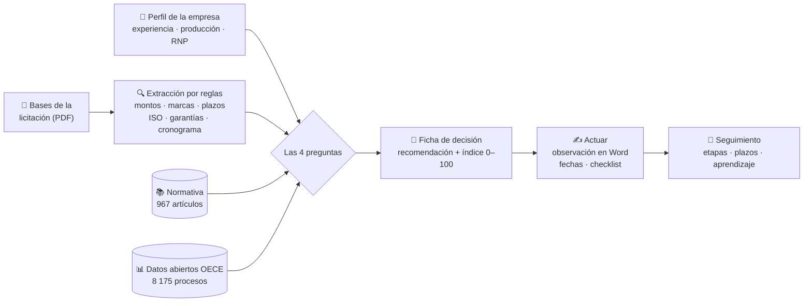
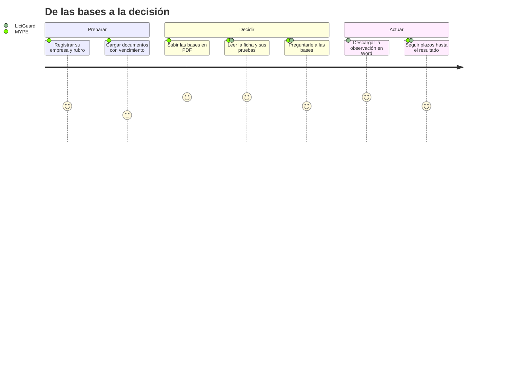
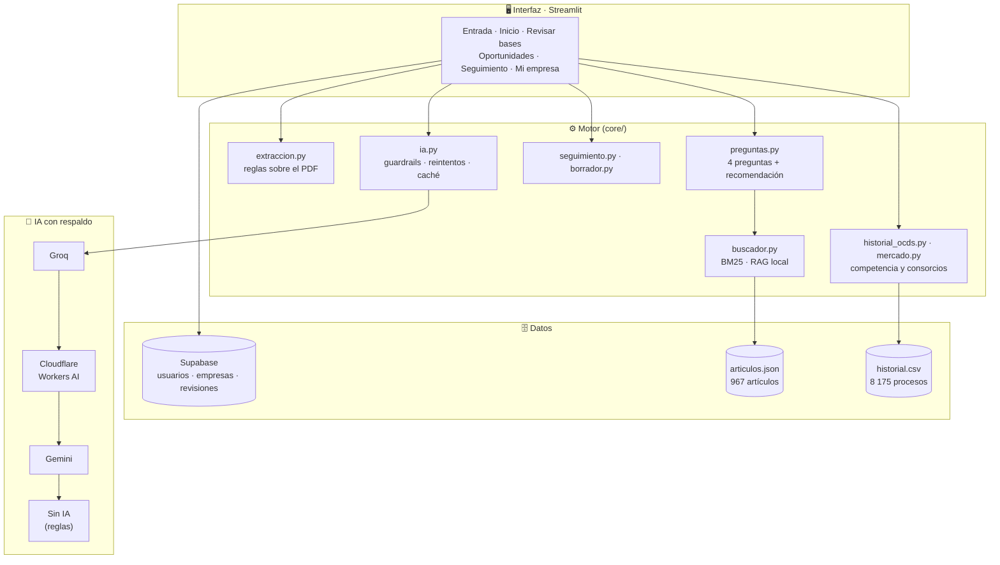

<div align="center">

# 🛡️ LiciGuard AI

### ¿Me presento a esta licitación?

**Copiloto para que las MYPE peruanas decidan con pruebas antes de venderle al Estado.**

<p>
  
  
  
  
  
  
  
</p>

<sub>
<a href="#-el-problema">El problema</a> ·
<a href="#-la-propuesta">La propuesta</a> ·
<a href="#-cómo-funciona">Cómo funciona</a> ·
<a href="#-módulos">Módulos</a> ·
<a href="#-arquitectura">Arquitectura</a> ·
<a href="#-alcances-y-limitaciones">Limitaciones</a> ·
<a href="#-puesta-en-marcha">Puesta en marcha</a> ·
<a href="#-autores">Autores</a>
</sub>

</div>

---

## 📌 El problema

Las micro y pequeñas empresas que quieren venderle al Estado peruano enfrentan una decisión difícil con cada
convocatoria: **¿vale la pena presentarse?** Para responderla deben leer bases de decenas de páginas y
contrastarlas con la normativa de contrataciones públicas. Además tienen que calcular si pueden cumplir con el
plazo y si el precio les deja ganancia, y estimar sus probabilidades frente a la competencia.

Ese análisis suele hacerse a ojo o no hacerse. Las consecuencias:
- se pierde tiempo preparando ofertas que no tenían posibilidad;
- se aceptan condiciones que la empresa no puede cumplir;
- se dejan pasar requisitos que favorecen a un proveedor y que podrían observarse a tiempo.

## 💡 La propuesta

**LiciGuard AI** convierte las bases de una licitación en una **ficha de decisión** que responde cuatro preguntas,
cada una respaldada por **la cita exacta del PDF** y **el artículo de la normativa** que corresponde:

<table>
<tr>
<td align="center" width="25%">⚖️<br/><b>¿Es justa?</b><br/><sub>¿Las bases tienen condiciones que restringen la competencia?</sub></td>
<td align="center" width="25%">🏭<br/><b>¿Puedo?</b><br/><sub>¿La empresa alcanza la experiencia, producción, plazos y documentos exigidos?</sub></td>
<td align="center" width="25%">💰<br/><b>¿Me conviene?</b><br/><sub>¿Qué queda después de IGV, costos y financiamiento?</sub></td>
<td align="center" width="25%">🏆<br/><b>¿Puedo ganar?</b><br/><sub>¿Qué dicen los procesos ya adjudicados del mismo rubro?</sub></td>
</tr>
</table>

El resultado es una recomendación clara (**Postular**, **Observar primero** o **No te conviene**), un **índice de
apertura de 0 a 100** y las herramientas para actuar: borrador de observación en Word, fechas del cronograma y
checklist de la oferta. La plataforma acompaña después a la empresa hasta el resultado de cada proceso.

### Por qué es diferente

| | Enfoque habitual | LiciGuard AI |
|---|---|---|
| **Respaldo** | Opinión o resumen genérico | Cada alerta muestra **la página y la cita resaltada** del PDF y el artículo de la ley |
| **Uso de IA** | La IA decide y puede inventar | El análisis lo hacen **reglas** repetibles; la IA solo explica en simple y responde preguntas, y dice "no sé" si no hay fuente |
| **Costo** | Consumo de tokens por cada análisis | Análisis gratuito y rápido; la IA se usa solo donde aporta |
| **Disponibilidad** | Depende de un único proveedor de IA | Cadena de respaldo **Groq → Cloudflare → Gemini → sin IA**, con reintentos, pausa de proveedores caídos y caché |
| **Contexto de mercado** | No disponible | **8 175 procesos adjudicados** reales para estimar competencia y encontrar socios |

---

## 🔎 Cómo funciona



### Recorrido de la empresa



---

## 🧩 Módulos

| | Módulo | Qué ofrece |
|:-:|---|---|
| 🚪 | **Portada y entrada** | Acceso con un código sin contraseña, creación de uno nuevo o prueba como invitado (sin guardar datos). Inicio de sesión con Google opcional |
| 🏢 | **Varias empresas** | Una misma persona gestiona varias empresas; revisiones, plazos, documentos, mercado y oportunidades se filtran por rubro y se guardan por separado |
| 🏠 | **Inicio** | Cinco indicadores, agenda de plazos, primeros pasos, decisiones recientes y el pulso del mercado con gráficos |
| 🧾 | **Ficha de decisión** | Recomendación, índice de apertura, seis datos clave de las bases y las cuatro preguntas con su indicador |
| 🔦 | **Pruebas en el PDF** | La página exacta con la cita resaltada, una explicación simple y el artículo relacionado |
| ✍️ | **Actuar** | Borrador de observación en Word, fechas leídas del cronograma y checklist de la oferta |
| 💬 | **Pregúntale a tus bases** | Asistente que responde solo con las bases y la normativa, y reconoce cuando no hay fuente |
| 🤖 | **Asistente flotante** | "Pregúntale a LiciGuard", con el contexto de la empresa y de la pantalla. Protegido: se niega a temas ajenos, a cambiar sus reglas y a revelar datos de terceros |
| 🎯 | **Oportunidades** | Dónde se compra el rubro, procesos a la medida de la empresa y **socios para consorcio** |
| 📌 | **Seguimiento** | Etapa de cada licitación, plazos por vencer y "aprende para la próxima" cuando no se gana |
| 🗂️ | **Mi empresa** | Perfil con capacidad de producción y RNP, documentos con vencimiento, recomendaciones "Para crecer" y control de los propios datos (descargar o borrar la cuenta) |
| 🎓 | **Ayuda integrada** | Recorrido guiado de la ficha, glosario (RNP, MYPE, garantía…), descripciones al pasar el cursor y "Siguiente paso" en cada página |
| ▶️ | **Demo en un clic** | Cuatro empresas modelo y una galería de bases (tres ficticias guiadas, una por recomendación, y bases reales del SEACE) |

---

## 🏗️ Arquitectura



**Decisiones de diseño**
- **Reglas primero, IA después.** El análisis es determinista: el mismo PDF produce siempre la misma ficha, sin costo por consulta.
- **Respuestas con fuente.** El asistente de las bases trabaja sobre un índice local (BM25) de las páginas y de la normativa, y no responde sin respaldo.
- **Tolerancia a fallos.** Si un proveedor de IA cae, el siguiente toma su lugar. Si caen todos, la aplicación sigue funcionando con reglas.
- **Privacidad.** Aviso de privacidad conforme a la Ley 29733, registro del consentimiento y opción de descargar o borrar todos los datos.

<details>
<summary><b>📁 Estructura del proyecto</b></summary>

```text
app.py                     Navegación y barra lateral
ui/                        Pantallas: entrada, inicio, revisar, oportunidades, seguimiento, empresa · tema visual
core/extraccion.py         Reglas que leen las bases (montos, marcas, plazos, ISO, garantías, cronograma)
core/preguntas.py          Las 4 preguntas y la recomendación
core/buscador.py           Búsqueda BM25 en normativa y páginas (RAG local)
core/historial_ocds.py     "¿Puedo ganar?" con datos abiertos (normaliza nombres de proveedores)
core/mercado.py            Oportunidades, socios para consorcio y "Para crecer"
core/seguimiento.py        Etapas, plazos, checklist y aprendizaje
core/ia.py                 Cadena de proveedores de IA con guardrails y reintentos
core/borrador.py · db.py · usuarios.py · pdf_parser.py · preparar.py · fechas.py (hora de Lima)
core/privacidad.py         Aviso de privacidad (Ley 29733) · core/bases_reales.py
supabase/01 … 06_*.sql     Esquema y migraciones
notebooks/                 Construcción de la normativa, datos abiertos, medición y bases reales
ejemplos/                  Bases ficticias para la demo · ejemplos/reales/: bases reales de la galería
tests/                     56 pruebas (motor, IA, bases reales y pantallas con AppTest)
```

</details>

---

## 📈 Avances logrados

- ✅ **Base normativa estructurada:** 967 artículos de la Ley 32069, su Reglamento y su modificación, cortados por artículo para citarlos con precisión.
- ✅ **Historial de mercado real:** 8 175 procesos adjudicados de datos abiertos (uniformes, mobiliario, limpieza y útiles de oficina), con nombres de proveedores normalizados.
- ✅ **Validación con bases reales del SEACE:** un cuaderno descarga bases reales, conserva las que sirven y ejecuta LiciGuard sobre todas.
- ✅ **Producto completo de punta a punta:** desde la entrada hasta el seguimiento del resultado, con varias empresas por usuario.
- ✅ **IA resiliente y protegida:** cadena de proveedores con respaldo automático, guardrails contra usos ajenos y respuestas con fuente.
- ✅ **Calidad verificable:** 56 pruebas automáticas, incluidas pruebas de pantallas con AppTest.

---

## ⚠️ Alcances y limitaciones

El equipo reconoce con transparencia los límites actuales del sistema:

| Limitación | Implicancia | Siguiente paso |
|---|---|---|
| Las señales son **alertas para revisar**, no conclusiones legales | La decisión final corresponde siempre a la empresa | Vincular cada alerta con jurisprudencia y pronunciamientos |
| En los datos abiertos, `n_postores` cuenta **participantes registrados**, no ofertas presentadas | La competencia real puede ser menor a la estimada | Cruzar con actas de otorgamiento de la buena pro |
| Oportunidades usa procesos **ya adjudicados** | Orienta sobre tamaño, compradores y competencia, pero no anticipa convocatorias | **Alertas de convocatorias abiertas en tiempo real** |
| Los umbrales de alerta son **criterios del sistema** | No equivalen a límites establecidos por la ley | Calibrarlos con especialistas en contratación pública |
| Los **PDF escaneados** aún no se analizan bien | Bases sin capa de texto quedan fuera del análisis | Incorporar **OCR** |
| Acceso por **código sin contraseña** | Quien conozca un código accede a su historial (los códigos son largos y hay límite de intentos) | Acceso por **enlace al correo** o Google en producción |

---

## 🚀 Puesta en marcha

### Requisitos
- Python 3.12
- Un proyecto en [Supabase](https://supabase.com). Sin él, la aplicación funciona en modo local.
- Claves de IA, opcionales: Groq, Cloudflare Workers AI, Gemini. Sin ellas funciona con reglas.

### 1 · Base de datos
En **SQL Editor → New query**, ejecutar en orden los archivos de `supabase/`:

| Archivo | Para qué |
|---|---|
| `01_esquema.sql` | Esquema principal |
| `02_seguimiento_y_documentos.sql` | Seguimiento y documentos |
| `03_rnp_vigente.sql` | Vigencia del RNP |
| `04_privacidad.sql` | Consentimiento del aviso de privacidad |
| `05_permisos.sql` | Permisos del servidor |
| `06_varias_empresas.sql` | Varias empresas por persona, con datos separados |

Las migraciones no borran ni modifican datos existentes. Si alguna falta, la aplicación sigue funcionando y lo advierte.

### 2 · Claves
Copiar `.streamlit/secrets.toml.example` como `.streamlit/secrets.toml` y completar `SUPABASE_URL`,
`SUPABASE_SERVICE_ROLE_KEY` y las claves de IA disponibles. Cada nombre debe aparecer una sola vez.

<details>
<summary><b>Cloudflare Workers AI (gratuito, no entrena con los datos)</b></summary>

1. En https://dash.cloudflare.com → **AI → Workers AI**, copiar el **Account ID** → `CLOUDFLARE_ACCOUNT_ID`.
2. En la misma página: **Use REST API → Create a Workers AI API Token** → `CLOUDFLARE_API_TOKEN` (se muestra una sola vez).
3. Verificar con `python probar_ia.py`: debe responder **OK Cloudflare**.

</details>

<details>
<summary><b>Inicio de sesión con Google (opcional)</b></summary>

El botón **"Entrar con Google"** aparece solo si se configura; sin configurarlo, el acceso por código e invitado sigue disponible.

1. En https://console.cloud.google.com, crear un proyecto.
2. **Google Auth Platform → Branding:** nombre de la aplicación y correo de soporte.
3. **Audience:** *External*. Durante las pruebas, agregar los correos en *Test users*. Para la evaluación, **Publish app** (con los permisos básicos de correo y nombre no requiere verificación).
4. **Clients → Create client → Web application.** En *Authorized redirect URIs*, agregar `http://localhost:8501/oauth2callback` y, al publicar, `https://SU-APP.streamlit.app/oauth2callback`. Copiar **Client ID** y **Client secret**.
5. Generar el secreto de la cookie: `python -c "import secrets; print(secrets.token_hex(32))"`.
6. Agregar **al final** de `.streamlit/secrets.toml`, sin nada debajo de `[auth]`:

```toml
[auth]
redirect_uri = "http://localhost:8501/oauth2callback"
cookie_secret = "EL_TEXTO_DEL_PASO_5"

[auth.google]
client_id = "....apps.googleusercontent.com"
client_secret = "GOCSPX-..."
server_metadata_url = "https://accounts.google.com/.well-known/openid-configuration"
```

</details>

### 3 · Instalar, probar y ejecutar

```bash
python -m venv venv
venv\Scripts\activate                 # Mac/Linux: source venv/bin/activate
python -m pip install -r requirements-dev.txt
python -m pytest -q                   # 56 passed
python -m streamlit run app.py
```

`requirements.txt` contiene las versiones probadas, las que usa Streamlit Cloud; `requirements-dev.txt` agrega pytest.

### 4 · Publicación (Streamlit Community Cloud)
1. Subir el proyecto a un repositorio **privado** de GitHub. `secrets.toml` y `venv` no se suben.
2. En https://share.streamlit.io → *Create app* → repositorio y `app.py`.
3. En *Advanced settings → Secrets*, pegar el contenido de `secrets.toml`.

---

## 🎬 Guion de demostración (3 minutos)

1. **Portada** → "Es mi primera vez" → aceptar el aviso de privacidad → crear el código.
2. **Mi empresa** → rubro "Uniformes y textiles", experiencia S/ 320 000, producción 3 000 prendas, RNP vigente → *Guardar*.
3. **Revisar bases** → subir `ejemplos/1_uniformes_observar.pdf` → leer la recomendación y las cuatro tarjetas. En "¿Puedo?" se ve que la producción no alcanza para 2 400 prendas en 5 días.
4. **Pruebas en el PDF** → elegir una condición: aparece la cita resaltada y el artículo del Reglamento.
5. **¿Me conviene?** → materiales S/ 330 000 y mano de obra S/ 170 000: la barra separa IGV, costos, financiamiento y ganancia.
6. **Explícamelo simple** → en la barra lateral, *Simular caída de Groq* → responde Cloudflare o Gemini.
7. **Actuar** → descargar la observación en Word y guardar fechas y checklist.
8. **Oportunidades → Socios para consorcio** y **Seguimiento** con el plazo por vencer.

---

## 🔄 Actualización de datos (Google Colab)

| Cuaderno | Propósito | Resultado |
|---|---|---|
| `notebooks/01_construir_rag.ipynb` | Descarga la normativa y la corta por artículos | `data/normativa/articulos.json` |
| `notebooks/02_historial_ocds.ipynb` | Descarga los datos abiertos, los clasifica en 19 rubros y los valida | `data/ocds/historial.csv` |
| `notebooks/03_opcional_medir_aciertos.ipynb` | Mide el porcentaje de aciertos de la extracción | Porcentaje de aciertos |
| `notebooks/04_bajar_bases_reales.ipynb` | Descarga bases reales del SEACE y ejecuta LiciGuard sobre todas | PDF en `data/bases/` + tabla de resultados |

Más detalle en [`CAMBIOS.md`](CAMBIOS.md) y en la [revisión técnica](docs/REVISION_TECNICA.md), que documenta la arquitectura, el estado de la IA, los hallazgos por área y el backlog priorizado.

---

## 👥 Autores

<table>
<tr>
<td align="center" width="33%"><b>Carolhay Ttito Carhuas</b></td>
<td align="center" width="33%"><b>Jorge Paima La Torre</b></td>
<td align="center" width="33%"><b>Fabrisio Aliaga Tolentino</b></td>
</tr>
</table>

---

<div align="center">
<sub><b>LiciGuard AI</b> · decisiones con pruebas para las MYPE que le venden al Estado · hecho en Perú 🇵🇪</sub>
<br/>
<sub>Las alertas son una ayuda para revisar las bases y no constituyen asesoría legal.</sub>
</div>
